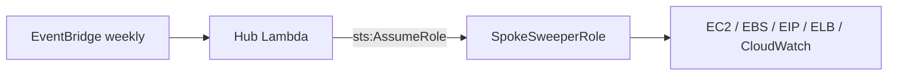

# Cloud Sweeper

Automated weekly waste remediation in a single account or across AWS Organizations using a Hub-and-Spoke model. Python 3.12, boto3, AWS Lambda, SAM, EventBridge.

- **EBS**: unattached volumes older than `MIN_AGE_DAYS` (snapshots, then deletes).
- **EC2**: idle instances with 7-day max CPU < `CPU_THRESHOLD` (stops and tags `StoppedBy=FinOpsSweeper`).
- **EIP**: unattached Elastic IPs (releases).
- **ELB**: orphaned ALBs/NLBs with empty or unused targets (**REPORT ONLY**, never deletes).

All sweeps skip resources tagged `FinOps:Action=Ignore` or `Environment=Production`.

## Architecture



## Demo (tested on a real AWS account)

Deployed with AWS SAM to a personal account, with throwaway resources created by hand.

**Dry run** (default, changes nothing):

```
DRY_RUN: Would snapshot and delete volume vol-0cfd2b79747258bb4
DRY_RUN: Would release EIP eipalloc-01314eab7f5604937
{"dry_run": true, "accounts_scanned": 1, "findings": {"ebs": ["vol-0cfd2b79747258bb4"], "ec2": [], "eips": ["eipalloc-01314eab7f5604937"], "elbs": []}, "errors": []}
```

**Live run 1**: snapshot first, volume kept until the snapshot completes:

```
Snapshot snap-056f8bb30b315554a pending; skipped deleting vol-0cfd2b79747258bb4
```

**Live run 2**: existing snapshot reused (no duplicate), volume deleted:

```
Deleted volume vol-0cfd2b79747258bb4
```

A volume attached to a running instance in the same account was left untouched. After the test, `DRY_RUN` was set back to `true` and all resources and stacks were deleted.

Note: the real-AWS demo used single-account mode. Multi-account mode (`SCAN_ORG="true"`) is covered by moto tests only.

## Environment Variables

| Variable | Default | Purpose |
|---|---|---|
| `DRY_RUN` | `"true"` | Log actions without mutating AWS resources |
| `REGION` | `"us-east-1"` | Target AWS region to scan (`template.yaml` defaults to `"eu-north-1"`) |
| `CPU_THRESHOLD` | `5` | Maximum CPU percentage to flag idle EC2 |
| `MIN_AGE_DAYS` | `7` | Minimum unattached age in days before EBS deletion |
| `SPOKE_ROLE_NAME` | `"SpokeSweeperRole"` | IAM role assumed in spoke accounts |
| `SCAN_ORG` | `"false"` | Scan current account when `"false"` (assumes `SpokeSweeperRole` via STS); scan all org accounts when `"true"` (`template.yaml` sets `"false"`) |

## Testing & Deployment

Run the unit tests (moto, no AWS account needed):

```bash
pytest -v
```

Deploy the Hub stack:

```bash
sam build
sam deploy --guided --capabilities CAPABILITY_NAMED_IAM
```

Then deploy the Spoke role, passing the Hub role ARN from the stack outputs:

```bash
aws cloudformation deploy --template-file spoke-role.yaml \
  --stack-name SpokeSweeper --capabilities CAPABILITY_NAMED_IAM \
  --parameter-overrides HubRoleArn=<HubRoleArnFromHubOutput>
```

Deploy `spoke-role.yaml` to **every** account (including the hub/single account), using CloudFormation StackSets for many accounts.

## Safety & Operations

- **Dry Run**: Keep `DRY_RUN="true"` for several weeks; review findings before setting to `"false"`.
- **Snapshot first**: a volume is deleted only after its snapshot is `completed`; an existing sweeper snapshot is reused.
- **Snapshots**: Snapshots tagged `AutomatedSweeper=True` are never auto-deleted (clean up via DLM).
- **Skipped on purpose**: protected tags, volumes younger than `MIN_AGE_DAYS`, instances in Auto Scaling groups.
- **Production SCP**: Apply an SCP denying `ec2:StopInstances`, `ec2:DeleteVolume`, and `ec2:ReleaseAddress` to `SpokeSweeperRole` in production OUs.

## Later

Deferred items: SNS/Slack reports, SQS fan-out for large orgs, Cost Explorer savings report, in-use public IP audit, ELB deletion, multi-region sweeps, and listing released Elastic IPs in the run summary.